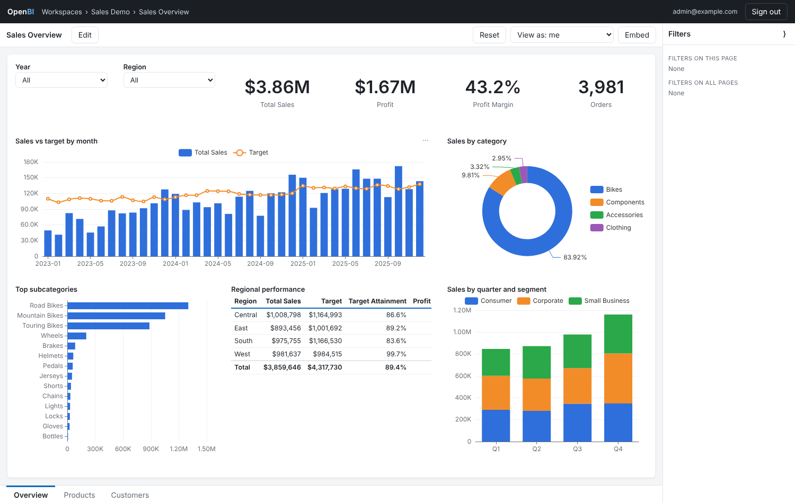
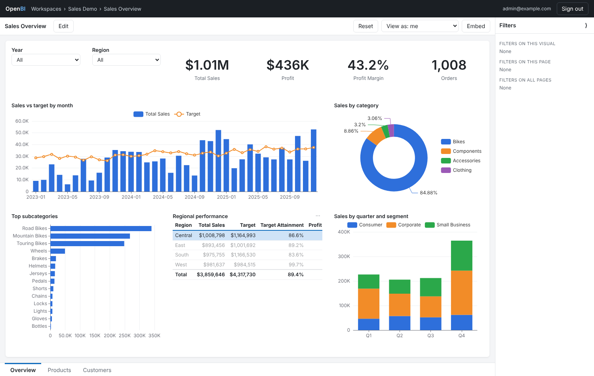
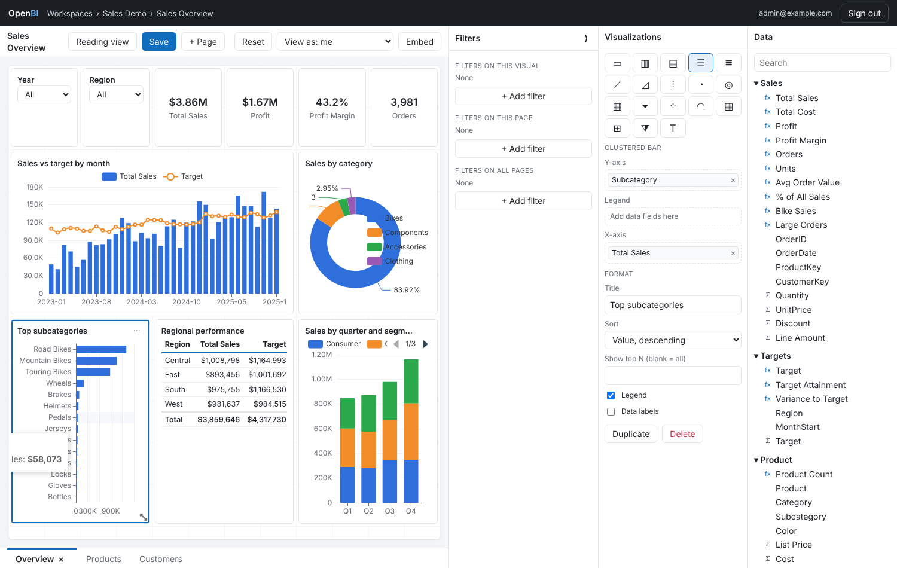
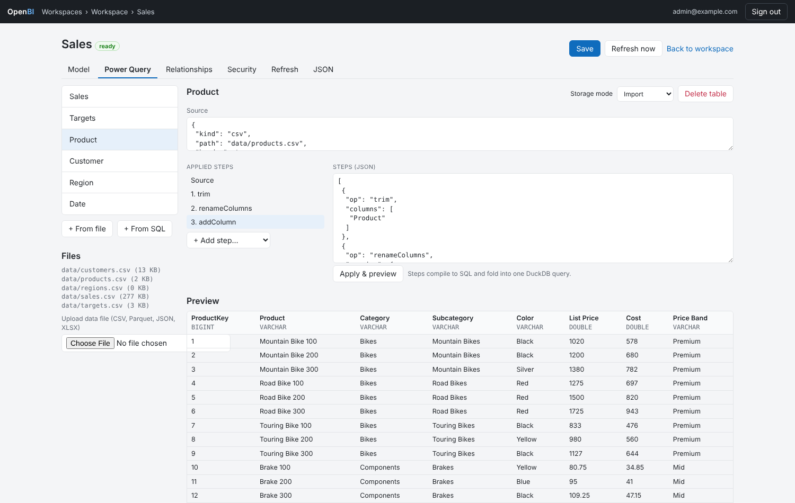
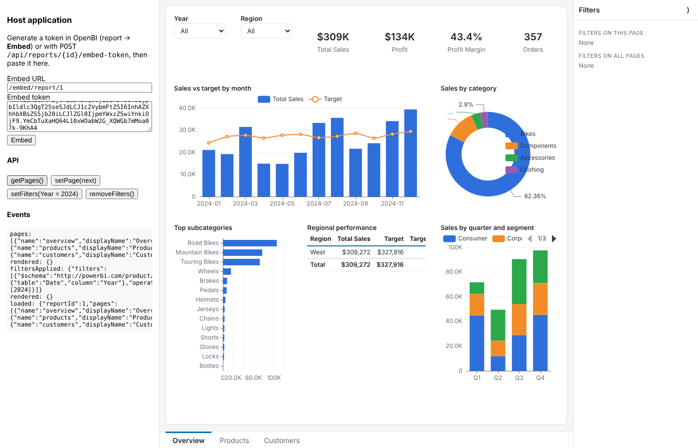
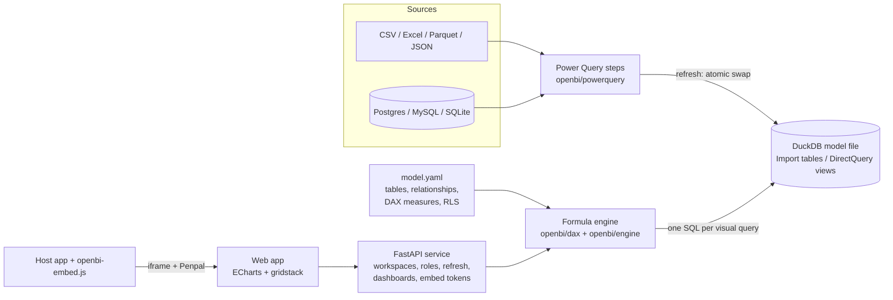

# OpenBI

[](https://github.com/rajasekharponakala/openbi/actions/workflows/ci.yml)
[](https://github.com/rajasekharponakala/openbi/actions/workflows/release.yml)
[](LICENSE)

**An open-source rebuild of the Power BI workflow.** You get data, transform
it with applied steps, model it with relationships and DAX measures, build
interactive reports, then share, secure (row-level security), schedule
refreshes and embed. It is built from existing open-source projects.



| | Power BI | OpenBI |
|---|---|---|
| Get data & transform | Power Query (M), query folding | Applied steps compiled to a single DuckDB query: CSV, Excel, Parquet, JSON, SQL, Postgres/MySQL/SQLite |
| Storage | VertiPaq (Import) / DirectQuery | DuckDB columnar file per dataset (Import) / views (DirectQuery) |
| Model | Tables, relationships, calculated columns, measures, RLS roles | Same, in a git-friendly `model.yaml` |
| Calculations | DAX formula engine | DAX subset with filter-context semantics: `CALCULATE`, `ALL`, iterators, `VAR`, … |
| Reports | Canvas, visuals, slicers, cross-filtering, filter pane | 18 visual types (ECharts), slicers, cross-filtering, report/page/visual filters, TopN, designer |
| Service | Workspaces & roles, scheduled refresh, dashboards, export | Workspaces (Admin/Member/Contributor/Viewer), cron refresh + history, dashboards, CSV/XLSX export |
| Security | RLS for Viewers, "test as role", `USERPRINCIPALNAME()` | Same |
| Embedding | Embed tokens + `powerbi-client` | Scoped embed tokens with effective identity + `openbi-embed.js` (same filter JSON and event names) |

Two docs explain how this was done. [docs/how-power-bi-works.md](docs/how-power-bi-works.md)
describes how Power BI works, including what [REA](https://github.com/morluto/rea)
showed about its public client contracts. [docs/foss-decisions.md](docs/foss-decisions.md)
explains why each piece is an existing open-source library, following the
[foss-mind](https://gitlab.com/ranjithraj/foss-agent-skills) skill.

## Install

Each [release](https://github.com/rajasekharponakala/openbi/releases) ships:

| Platform | Package |
|---|---|
| Windows | `openbi-<version>-windows-x86_64-setup.exe` (installer with Start-menu entries) or the portable `openbi-<version>-windows-x86_64.exe` |
| Debian / Ubuntu | `sudo apt install ./openbi_<version>_amd64.deb` (or `_arm64`), then `sudo systemctl enable --now openbi` |
| Fedora / RHEL / SUSE | `sudo dnf install ./openbi-<version>-1.x86_64.rpm` (or `.aarch64`) |
| macOS | `openbi-<version>-macos-arm64.tar.gz` / `-macos-x86_64.tar.gz` (single binary) |
| Any Linux | `openbi-<version>-linux-x86_64.tar.gz` / `-linux-arm64.tar.gz` |
| Python | `pip install openbi-<version>-py3-none-any.whl` |
| Docker | `docker run -p 8000:8000 ghcr.io/rajasekharponakala/openbi` |

The `.deb`/`.rpm` packages install `/usr/bin/openbi`, a hardened systemd unit
(`openbi.service`, running as the `openbi` system user), settings in
`/etc/openbi/openbi.env` and data in `/var/lib/openbi`. Create the first
administrator with
`sudo -u openbi OPENBI_HOME=/var/lib/openbi openbi create-user you@example.com --admin`.

## Quick start (from source)

```bash
python -m venv .venv && . .venv/bin/activate
pip install -e ".[dev]"
openbi demo            # seeds users, a workspace, the sample dataset and report, then serves on :8000
```

Open http://127.0.0.1:8000 and sign in with one of the demo accounts. The
passwords are demo values. Change them, or create real users with
`openbi create-user`.

| Account | Password | Sees |
|---|---|---|
| `admin@example.com` | `openbi-admin` | everything (workspace Admin, can edit) |
| `avery@example.com` | `openbi-viewer` | Viewer, row-level security: West only |
| `jordan@example.com` | `openbi-viewer` | Viewer, East only |

Docker:

```bash
docker build -t openbi .
docker run -p 8000:8000 -v openbi-data:/data openbi openbi demo --host 0.0.0.0 --port 8000
```

### Without the server

```bash
openbi sample ./sales            # project folder: model.yaml, reports/, data/
openbi validate ./sales          # compile every measure
openbi refresh ./sales           # run the queries into ./sales/.openbi/model.duckdb
openbi query ./sales "Product[Category]" "[Total Sales]" "[% of All Sales]"
openbi query ./sales "Region[Region]" "[Total Sales]" --role "Regional Manager" --user avery@example.com
openbi publish ./sales --workspace Finance --owner admin@example.com
```

## Tour

**Reports.** Clicking a data point cross-filters the other visuals on the
page. Slicers, the filter pane (report, page and visual scopes) and TopN
filters work as they do in Power BI.



**Designer.** Pick a visual type, then click or drag fields into its wells.
Numeric columns become implicit measures (Sum, Average, …). Visuals can be
moved and resized, and pages can be added and renamed.



**Power Query.** Each table is a source plus applied steps. Click a step to
preview the data at that point. The steps fold into one SQL query.



**Embedding.** Generate an embed token with an effective identity, then
drive the report from the host page with the SDK.



## Architecture



A visual's query has the same shape as DAX `SUMMARIZECOLUMNS`: group-by
columns, filters and measures. The engine compiles each measure into
aggregate *leaves*. Each leaf is evaluated in a subquery over its home table,
in its own filter context: the visual's filters after any `CALCULATE`
modifiers. Filters reach that table through its relationships. The engine
then joins the subqueries on the group keys still in context. DuckDB runs the
resulting single statement. Every visual query is one SQL statement, which
authors can inspect with **⋯ → Show query (SQL)**.

## Documentation

- [How Power BI works & how OpenBI maps to it](docs/how-power-bi-works.md), including the REA evidence
- [Supported DAX](docs/dax.md)
- [Project format: model.yaml, steps, report JSON](docs/project-format.md)
- [Embedding](docs/embedding.md)
- [FOSS decisions](docs/foss-decisions.md)
- [Roadmap / gaps](docs/roadmap.md)
- REST API: `/docs` (OpenAPI) on a running server

## Configuration

| Variable | Default | |
|---|---|---|
| `OPENBI_HOME` | `./openbi-data` | metadata DB, dataset files, secret key |
| `OPENBI_SECRET` | generated into `$OPENBI_HOME/secret.key` | JWT signing key |
| `OPENBI_DATABASE_URL` | `sqlite:///$OPENBI_HOME/openbi.sqlite` | any SQLAlchemy URL |
| `OPENBI_ALLOW_DATABASE_SOURCES` | off | allow `database` sources (Postgres/MySQL/…); file sources are always sandboxed to the dataset folder |
| `OPENBI_QUERY_TIMEOUT` | `30` | seconds per visual query |

## Development

```bash
pip install -e ".[dev]"
pytest -q                 # engine results are checked against hand-written SQL
ruff check openbi tests && ruff format --check openbi tests
scripts/analyze-powerbi-sdk.sh   # re-run the REA analysis of the Power BI client packages
pyinstaller packaging/openbi.spec  # build the single-file executable into dist/
```

Releases, packaging and the repository labels are described in
[docs/releasing.md](docs/releasing.md).

## License

[AGPL-3.0-only](LICENSE). Vendored front-end libraries keep their own
licences: ECharts (Apache-2.0), gridstack.js (MIT) and Penpal (MIT). They are
in `openbi/web/static/vendor/licenses/`.

Power BI is a trademark of Microsoft. OpenBI is an independent project and
is not affiliated with or endorsed by Microsoft.
